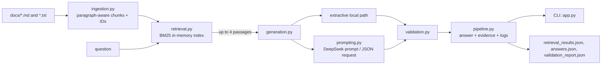

# Design Notes: Local Support Knowledge Base

## Purpose and scope

This repository implements a small, runnable support-question answering service over local product and policy documents. It demonstrates the requested separation of ingestion, retrieval, prompting, generation, and deterministic validation. The implementation uses Python 3.10 or newer and has zero third-party runtime dependencies. The sample corpus contains five Markdown documents; evaluation inputs and generated retrieval, answer, and validation artifacts are checked in.

The intended boundary is a lightweight internal documentation helper, not a general chatbot or a production authorization system. Questions and local documents are the knowledge inputs. Evaluation labels are used only to report behavior matches; they are not used to generate answers.

## Architecture

`ingestion.py` reads only top-level `.md` and `.txt` files from the selected corpus folder, in stable filename order. It splits on blank-line paragraph boundaries, combines paragraphs up to 900 characters, and slices longer paragraphs into bounded chunks. Each chunk carries the original filename (`doc_id`), a stable stem-based `chunk_id`, and its text. The index is built in memory for each run and is not persisted.

`retrieval.py` tokenizes text into lowercase word tokens and scores each chunk with a dependency-free BM25 implementation. Results are sorted deterministically and capped at the top four positive-scoring chunks. Scores are raw BM25 values, not calibrated probabilities.

## Generation and grounding

`generation.py` exposes replaceable provider selection. The default offline path selects a sentence from retrieved passages only when its normalized terms cover all material question terms; quantity-shaped questions also require numeric evidence. It uses a small conservative alias/inflection map. This can refuse valid paraphrases, but it avoids adding a heavyweight vector database, model download, or network dependency to a small clean-checkout demo.

The offline generator also applies a weak-retrieval gate: it refuses when the highest raw BM25 score is below `min_score=0.35`. This is a bounded practical stretch for the local path, not a confidence estimate; the value is not calibrated across corpora or query distributions. It is not applied as a pre-generation gate to DeepSeek.

The optional DeepSeek path builds a JSON request using `PROMPT_TEMPLATE`, a Python constant in `prompting.py` (it is not an external text template). The prompt treats both question and evidence as untrusted data and instructs the model to rely only on supplied passages, return exact quoted evidence, and state gaps for unsupported or partially supported requests. The provider is called even when retrieval returns no chunks; there is no guaranteed code-level no-hit short circuit for this path. Prompt instructions and deterministic checks reduce risk but do not prove complete entailment or make hallucinations impossible.

## Validation, outputs, and observability

`validation.py` checks the exact response schema, boolean support flag, nonempty answer, presence of citations for supported answers, membership of cited document/chunk pairs in retrieved results, literal quote containment, and that answer numbers occur in the cited quote. Unsupported answers must clearly state a refusal or gap. Invalid generations are replaced with a fixed refusal and the original generation validation remains visible.

The CLI returns the answer, support status, citations, retrieved source chunks, and internal evidence. Evaluation `retrieval_results.json` records retrieved chunks and raw scores. Public `answers.json` records document-level citation IDs and an `evidence` array containing all retrieved passages, not only the exact passages or quotes selected by the model; the exact model-selected quote checks are validated internally and returned by the one-question CLI, but are not retained as such in evaluation outputs. Document-level citation IDs can repeat when multiple citations refer to one document.

Structured stage logs record ingestion counts, retrieval, generation/provider status, and validation. The package excludes logs and environment files. The DeepSeek key is read from process environment or an explicitly supplied env file and is not included in artifacts.

## Acceptance trace and verification

- Local document ingestion, chunk metadata, searchable retrieval, and top-four results: implemented in `ingestion.py` and `retrieval.py`; saved in `retrieval_results.json`.
- Grounded answers, refusal behavior, citations, and deterministic support checks: implemented in `generation.py` and `validation.py`; saved in `answers.json` and `validation_report.json`.
- A replaceable offline/DeepSeek generation path and one-question CLI: implemented in `generation.py`, `prompting.py`, and `app.py`.
- Focused tests and observability: `tests/test_pipeline.py` covers core pipeline behavior; JSONL stage logging is provided by `pipeline.py` and CLI logging.

The recorded primary acceptance in `artifacts/acceptance_summary.json` reports nine unit tests passed, offline evaluation 9/9 behavior matches and structural checks, and actual main-process DeepSeek evaluation 9/9 with zero provider errors or fallbacks. Three additional real DeepSeek checks passed (a new HTTP 429 question, an unknown identity fee, and a partly supported documents-plus-fee request). The earlier worker-sandbox network failure was superseded by this successful live verification. `SELF_CHECK.md` summarizes the same evidence.

## Decisions, limits, and next steps

BM25 and extractive generation keep setup deterministic, offline, and dependency-free, at the cost of lexical sensitivity and conservative refusals. The index is rebuilt per run and does not scale to large corpora. There is no user identity, role-based access control, or document-level ACL; all documents in the chosen corpus are treated uniformly. If company authorization is added later, access filtering must happen before retrieval and before any document reaches model context, citations, or logs. Prompt wording alone is not enforcement.

The checks establish structural citation and quote properties, not full semantic entailment. DeepSeek can be asked to answer without a pre-generation no-hit gate, duplicate document IDs may appear in citations, and evaluation evidence is broader than the model-selected quote set. Future work could add calibrated retrieval evaluation, explicit no-hit gating for every provider, claim-level entailment checks, persistent indexes, and authorization-aware retrieval. Those are extensions, not capabilities claimed by this version.
